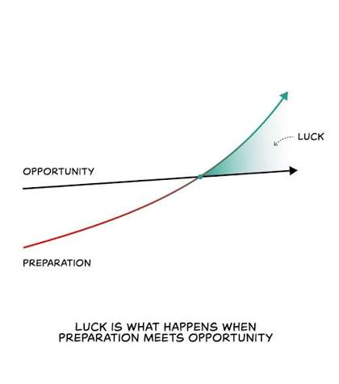

Dear You,

*the reader*. it is in lowercase on purpose. lowercase just caught your attention better than an uppercase "traditional" piece of writing. 

for the greater part of the past couple of years, I was always told that people find their passion, or start businesses, or get ideas suddenly - No one sat down and started a focus session to think about their idea or find their passion. It was a spiral of either doing alot of different things and finding what settles, or solving problems that were genuinely irritating, or watching from behind the noise and thinking of ways to make something better.

here comes what I fell into, I thought I never had it. I was actually enjoying engineering, but I was also certain that human civilzation didn't come to what it is by being focused on one niche. Why can't the guy who designs the circuit, also do the enclosure ? - humans are adaptable and are open to learning as many trades and skills as possible. So to extend my pool, I had to force myself to find my *extended* passion, forced myself to think of other outlets of things I enjoy. Then one time somewhere around in 2022, while scrolling on Instagram - I saw a poster for an event at the university. My first thought was *cmon guys you can do better*, so I reached out, and put myself forward to do the "better". My better caught everyones attention, and -to this day- I have become the designated poster designer. It has come to me. I only realised this now - 4 years later - after spending so long looking for a passion or another outlet besides engineering. 

it was only right now to combine them all somewhere, so I launched this website to put out everything I do, for myself to reflect. To look back, and be grateful, and to set a higher standard for my current work.

## the beauty of fate

you can't force it. everything comes to you at its designated time. What you can do is to be prepared because when fate throws opportunities at you, theres nothing harder to bear than not being able to take it in, knowing that you could handle it - you just weren't ready.

in alot of interviews and podcasts, many millionaires and billionaires describe what happened to them as *"luck"*. its the easy word of " i dont know which point specifically tipped everything". they worked hard for sure, they had to give up things in exchange for other things, and they had to sacrifice - but luck is easier to say because they don't know which one of that caused the success. in my favorite quote of all time shown below:

> luck is what happens when preparation meets opportunity

and this is exactly what happened with you, and I at every phase of life. You got the job, because you were prepared. The business worked, because you were prepared. You got married, because you were prepared.

and in the grand scheme of things, this concept perfectly fits in the idea of "saai" in Islam that God rewards muslims for their work and effort rather than outcome - *there are too many variables that affect too many things.*

time to do more prepration, dnd on, head down, back to work...

