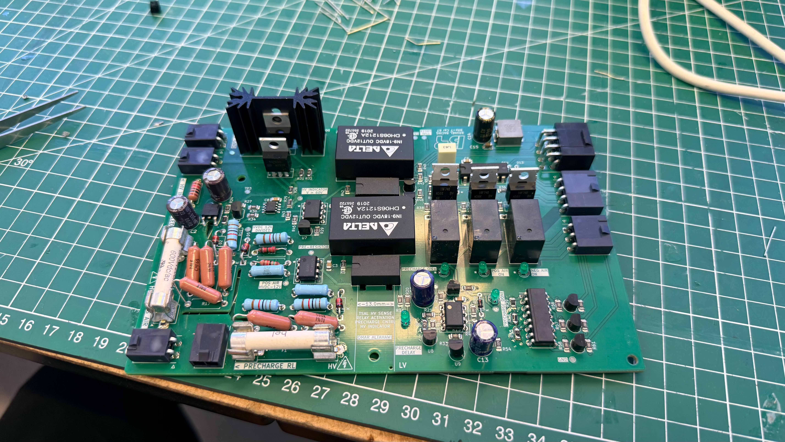
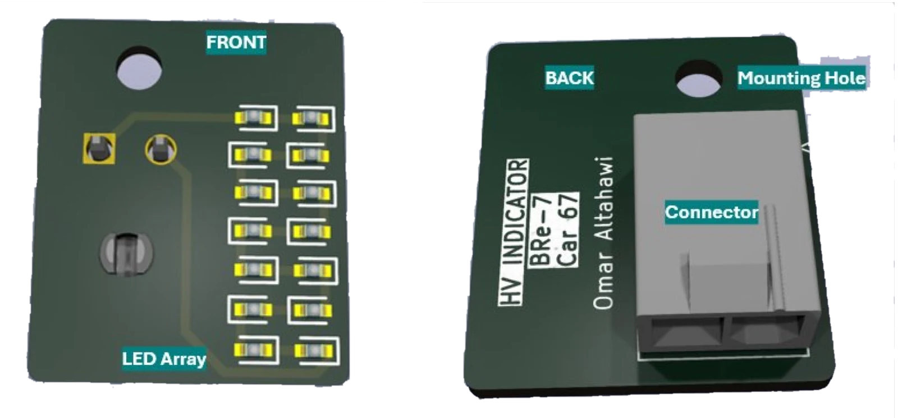
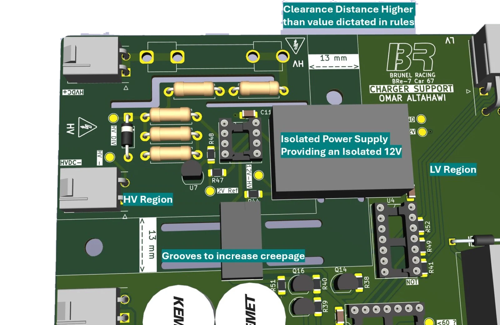

BRe-7 is Brunel Racing's seventh electric Formula Student car. Earlier cars ran, but none passed scrutineering: they had missing safety circuits, boards scattered around the battery box, and rules that had changed while the project sat on hold for a year. I was the only electrical engineer on an 8-person technical team, so the high voltage side, the low voltage side ([covered here](/engineering/bre7-low-voltage-systems/)) and the integration between them were all mine.

This page covers everything inside the **TSAC**, the Tractive System Accumulator Container that holds the high voltage battery, plus the charger.

## Design idea 1: four boards become one

In the old TSAC the precharge, contactor (AIR) activation, HV indicator and TSAL sensing were spread across separate PCBs, wired in loops around the battery modules. All four have one thing in common: **they all measure voltage at the AIRs**. So I merged them onto one board that shares that HV interface.

- **Before:** 4 boards, 95 components, 25,175 mm²
- **After:** 1 board, 136 components, 18,894 mm² (**25 % smaller** with 41 % more parts)
- The extra parts are compliance features, flyback diodes, status LEDs and test points, not bloat

Fewer boards meant fewer harnesses, fewer connectors to fail, and room in the new TSAC for proper wire terminals.

## Design idea 2: one HV sensing block, reused everywhere

About five circuits on the car need to answer the same question: *is this bus above or below 60 V?* Rather than solve it five times, I designed one block and copied it into every board that needs it:

1. A **200 mA fuse** right at the HV tap
2. Two **500 kΩ, 1 W through-hole resistors** take most of the voltage, followed by 2 × 18 kΩ: 302 V becomes 10.49 V, and 60 V becomes 2.08 V
3. A **12 V Zener clamp** on the measurement node, so a shorted 500 kΩ resistor can't push pack voltage into the comparator
4. An **LM4040 2.048 V precision reference** instead of a second divider. Improving temperature stability, and protection against voltage variations
5. An **LM311** comparator driving an **optocoupler**, so the result crosses the isolation barrier as light rather than copper to isolate grounds

Standardising this block also cut the number of different part numbers to order and solder.

## Design idea 3: an HV indicator with no DC-DC converter

The rules require a red light that is on whenever the DC link is above 60 V, powered **from the HV pack itself**, so it works even if the low voltage system is dead. The previous design used a bulky, expensive isolated DC-DC converter to get 12 V from 300 V.

I replaced it with an all-silicon chain:

**300 V → 12 V linear regulator → nanopower comparator → BJT current mirror → LED string**

- The **LR8** high-voltage linear regulator can only dissipate about 1.23 W, which allows around **4 mA** at 300 V in. That budget drove every choice after it.
- The **TLV3701** comparator draws **56 nA**, so practically the whole budget is left for the LEDs.
- An **emitter-degenerated current mirror** (the most stable mirror topology) multiplies a small reference current by about 6. In simulation, 866 µA in gave 4.9 mA out, drawn directly from the HV rail.
- **14 series LEDs** all get identical current from the mirror, with no per-LED resistors.
- A deliberate **10 kΩ dropper** takes 48.9 V away from the transistor, leaving it about 1.1 W to dissipate. That fits under a small heatsink.

The result costs **60 % less** than the old design. The LED board has its connector on the back so it sits flush with the TSAC wall, and it is conformally coated because it is tied directly to the HV bus.

## Design idea 4: precharge that turns itself off

The inverter's 200 µF DC link would draw a huge inrush current if the positive contactor closed straight onto it. The precharge circuit routes current through a 1 kΩ resistor first:

- A comparator waits until the inverter side reaches **97 %** of pack voltage
- An RC delay then adds **2 seconds** before declaring precharge done, so a single noisy comparison can't trigger it
- A second RC opens the precharge relay **430 ms** after the positive AIR closes. The old design left current flowing through the resistor, wasting power and heating the inside of a sealed box.

## Design idea 5: contactors closed in a strict order

The three contactors (negative AIR, precharge AIR, positive AIR) close in that sequence, each gated by logic: tractive system requested, BMS reports it is safe to discharge, and precharge state. The positive AIR also accepts a *charger override*, because charging doesn't need precharge.

The GIGAVAC coils draw up to **3.9 A at switch-on**, so:

- Logic gates can't drive them directly. They feed an **MCP14E4 MOSFET driver**, which drives an **IRF740**, which drives a relay, which switches the AIR coil to ground.
- **20 Ω gate resistors** damp the ringing from the driver's large output current.
- The shutdown circuit feeds the *high* side of every AIR coil and this logic controls the *low* side, so either one alone can open the contactors.

The TSAL needs to know what each contactor was *told* to do, not just what it did. The activation relays only provide a path to ground, so tapping that signal directly would interfere with it. Instead, a **quad optocoupler** sits in series with each relay path and a MOSFET re-inverts its output into a clean "intent" signal. No previous Brunel car had this, and the TSAL rules require it.

## PCB principles for boards that carry 300 V

Several of these boards have 300 V and 12 V on the same piece of fibreglass. The layout approach:

- **Creepage and clearance** follow the rulebook's separation table (EV4.3.6). Where the surface path was too short, I **milled slots through the board** to make it longer.
- **Nothing conductive crosses the barrier.** Power crosses through **isolated DC-DC modules** large enough that their pins sit far enough apart, and signals cross through **optocouplers**.
- **HV parts are through-hole, rated 1 W**, and fused at the tap.
- **4-layer stack-up on every board**: signals on the outer layers, a solid **ground plane** on layer 2 and a filtered **12 V plane** on layer 3.
- **Track widths sized to IPC-2221** from current and acceptable temperature rise. Long runs are widened for voltage drop even when the current is small.
- **Thermal-relief connections** to the ground pour, so the planes still conduct well but pads can be hand-soldered.

## Electronics first, then the box

On previous cars the mechanical team designed the battery box and the electronics were squeezed in afterwards. This time I worked with the powertrain engineer from the start, and the TSAC became a **two-deck design**: modules lying flat on the bottom with cooling channels between them, and all electronics on an accessible top deck with wire terminals, connectors on the side walls, and cutouts for every indicator. Consolidating the boards is what freed up the top deck.

## What I learned

Most of the work was reading. The rulebook usually states the exact behaviour a circuit needs, and reverse-engineering what earlier teams built (and why it failed scrutineering) produced most of my design specs. If I did it again I'd start the handover over the summer, and push for at least three electrical engineers: one for the TSAC, one for low voltage, and one for wiring and integration.
