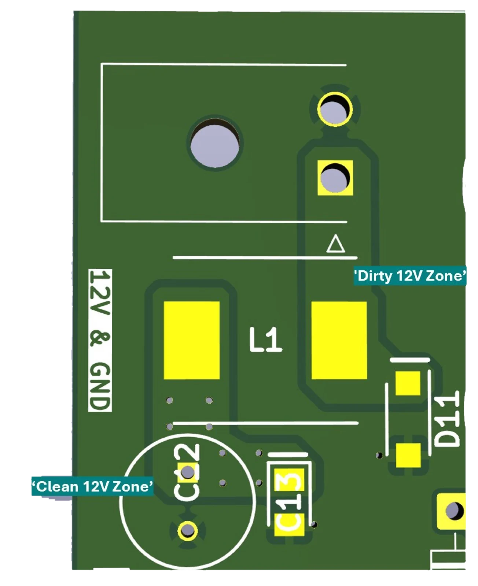
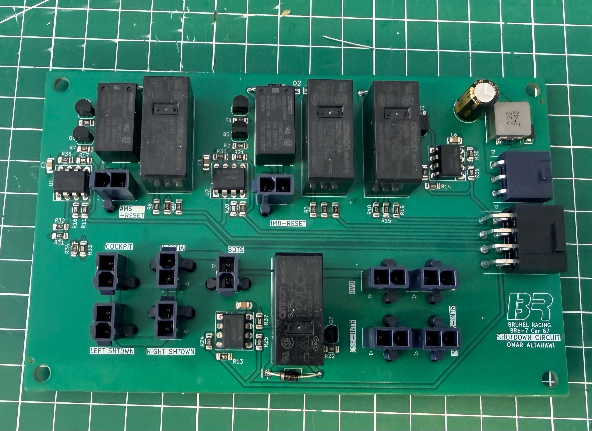
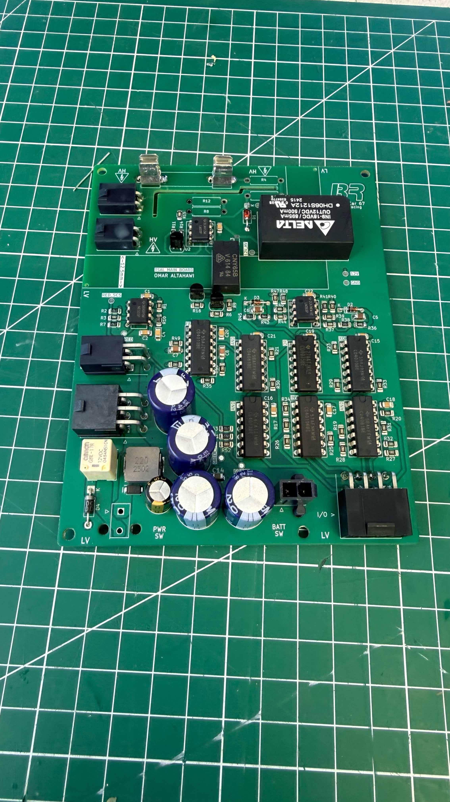
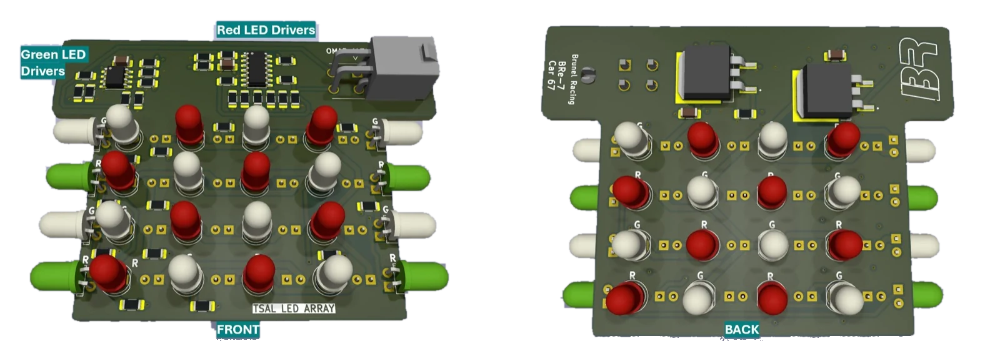
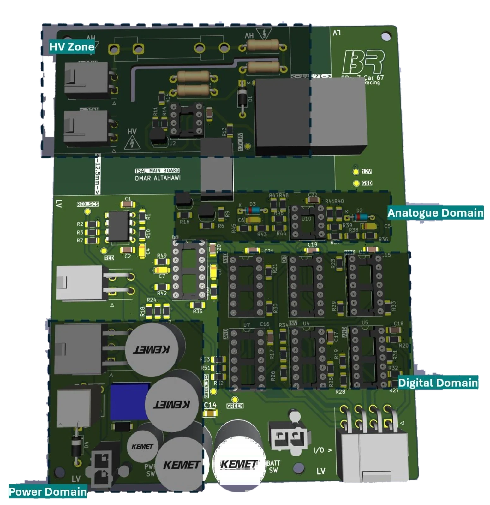

This is the second half of my MEng project on Brunel Racing's BRe-7 electric car for Formula Students UK. The [high voltage page](/engineering/bre7-high-voltage-systems/) covers the battery box. This one covers the 12 V side: the circuits that decide when the car is allowed to be live, and tell everyone around it.

Previous Brunel cars failed in the same ways here. Their safety signals couldn't tell a real "safe" from a broken wire, the TSAL mixed two functions in a way the rules don't allow, the shutdown board was confirmed faulty, and the low voltage batteries had no monitoring, which the rules require. I redesigned these systems from scratch.

## The foundation: two building blocks on every board

Before designing any individual board, I designed two blocks to reuse on all of them.

### 1. Power conditioning that assumes the 12 V rail is hostile

A single 12 V LiFePO4 battery feeds the contactors, inverter, fans, lights and every control board: resistive, inductive and capacitive loads all on one rail. In a car that rail is noisy and can spike to **three times its nominal voltage**. Every board starts with the same front end, placed right at its power connector:

- **TVS diode (SMA6F13A)**: begins conducting just above the battery's 13 V maximum and clamps at 20.4 V, so normal operation wastes nothing and spikes go to ground instead of into the ICs
- **22 µH shielded inductor**, rated 6 A with 50 mΩ DC resistance, so **one part number covers every board**
- **100 µF electrolytic in parallel with a 10 µF ceramic**: the electrolytic handles low-frequency ripple and the ceramic, with its low parasitic inductance, handles high-frequency noise
- The result is an LC low-pass filter at **about 3.2 kHz**, far below the 150 kHz+ range where most automotive noise sits
- Copper pours instead of thin tracks between the parts, and the module sits **next to the connector** so noisy current never travels across the board

### 2. Safety-critical signals that can detect a cut or shorted wire

The rules (T11.9) say any signal that can trigger shutdown, control torque or drive a safety indicator must detect **open circuits, shorts to ground and shorts to 12 V**. Neither BRe-4 nor BRe-5 did this, which on its own made both cars non-compliant.

The idea is simple: **never let a valid signal be 0 V or 12 V.**

- **Sender side:** a three-resistor network shifts each signal from 0–12 V into roughly **2.5–10 V**. A healthy "low" is now 2.5 V, not ground.
- **Receiver side:** a **window comparator** (two halves of an LM339) only reports OK while the signal sits inside the window. A short to ground (0 V) or to supply (12 V) lands outside it and counts as a fault.
- A **pull-down on the input** means an open wire floats to 0 V, which also counts as a fault.

I standardised this pair across every board that sends or receives a safety signal, and verified it in LTSpice by sweeping the input from 0 to 12 V.

## The shutdown circuit

The shutdown circuit is a long series loop: cockpit and side kill buttons, brake-over-travel switch, inertia switch, interlocks, BSPD, IMD, AMS, TSAL. It powers the high side of the battery contactors, so if any element opens, the car goes dead.

- **Non-latching faults** (BSPD, TSAL power) use a MOSFET driving a DPST relay. One contact pair sits in the shutdown loop, and the other drives a status light on the dash for free.
- **Latching faults** (IMD and AMS) must keep the car off even after the fault clears, until someone presses reset. Two relays do this. When the fault relay energises, it also gets a second path to ground through a normally-closed reset button, so it holds itself on after the fault disappears. Pressing the button breaks that path and the loop recovers. It needs no microcontroller and has no firmware to get wrong.
- The loop current drives contactor coils, so its tracks are **2.0 mm wide (good for 3.9 A under IPC-2221)**.
- **Molex Mini-Fit Jr.** connectors throughout. They are rated 13 A and 600 V, latch positively, and self-align. They replace Micro-Fit, which is unreliable under vibration, and oversized Mini-Fit Sr.
- The result is **10 % smaller** than the old (non-compliant) board, while adding fault detection on every input.

## The Tractive System Active Light (TSAL)

The TSAL sits on top of the car and tells everyone whether the vehicle is safe to touch:

- **Solid green:** all contactors open, precharge open, and under 60 V on the vehicle side
- **Flashing red at 2–5 Hz:** DC link above 60 V
- Visible in bright sunlight from every angle, and still lit **15 minutes after the car is switched off**
- Green and red must be decided by **independent circuits**, and any **implausibility must kill the green and latch it off**

I built it with **no microcontroller**. Every state comes from a truth table and CMOS logic, so its behaviour can be checked by hand.

### Power that survives switch-off

The old TSAL ran on NiMH cells with no monitoring, which the rules don't allow. It now has its own **7.5 Ah LiFePO4** battery, which is exempt from the monitoring rule. A 20 A Omron relay powers the TSAL from the main 12 V rail while it's live and falls back to the battery when it isn't. The relay takes **5 ms** to change over, which is long enough to reset the logic, so an **8,800 µF capacitor bank** covers the gap. C = I·Δt/ΔV gives 7,500 µF for a 1 V droop, and I sized up from that for derating.

### Red: a 555 timer

The 60 V detector (the same HV sensing block used throughout the car) enables a **555 astable** set to **3.2 Hz**. Simulation shows 3 Hz at a 51 % duty cycle, inside the 2–5 Hz, 50 % requirement. After SCS scaling the signal swings between 2.55 V and 9.45 V with timing unchanged.

### Green: two plausibility checks as boolean algebra

1. **Did each contactor do what it was told?** The inputs are: is the coil's high side powered (A), is the contactor commanded closed (B), and do its auxiliary contacts report closed (C). I wrote out the 8-row truth table and reduced it with K-maps to **Error = (A·B) ⊕ C**. That logic is repeated for all three contactors and OR'd together.
2. **Does contactor state match measured voltage?** A 16-row truth table across the three contactors plus "voltage under 60 V", again reduced with K-maps, flags combinations like "every contactor is open but there's 300 V on the bus".

Some details that make it robust:

- **CD4000-series logic**, chosen over 74-series because it runs directly from 12 V (up to 18 V). That removes a 5 V regulator and its parts from the BOM.
- The **40106 hex inverter** has built-in hysteresis, so signals that arrive slowly or noisily over long wires don't cause chatter.
- **Pull-downs on every input that comes in over a wire**, so a disconnected cable reads as a defined level, not a floating one.

### Latching without false trips

A **CD4013 flip-flop** latches the error through its asynchronous Set pin. Latching locks the car out, so a single glitch must not trigger it. An RC delay feeding a comparator means an error must persist for **400 ms** before it latches. A **power-on reset** RC pulses the flip-flop's Reset pin at start-up so it always begins in a known state. I simulated the delay, the latch, and the fact that the light *stays off* after the fault clears in Multisim.

### The light itself

- **Window comparators on the light board too**: the red and green signals are safety-critical, so the light board checks they are valid before it acts on them
- The flashing red signal is **regenerated locally** by a comparator once its window check passes, so the light board drives clean edges instead of whatever arrived over the harness
- **Red:** 20 × Cree 8,925 mcd LEDs in 5 strings of 4 (4 × 2.3 V = 9.2 V), so **one 80 Ω resistor per string** instead of one per LED
- **Green:** 50,000 mcd, 15° LEDs. Their forward voltage is higher, so the strings are 3 and 2 LEDs long
- LEDs on **both faces and the edges** of a T-shaped board, so it's visible from every direction. The electronics are tucked into the top of the T, which the mechanical team will enclose.

## Component discipline

- **Derating on everything**, following *Designing Electronics That Work* book, with some limits taken from NASA's space-electronics guidelines: capacitors at 60 % of rated voltage, MOSFETs at 75 % of rated current and voltage, linear ICs at 80 %
- **Capacitor type chosen by function**: electrolytic for bulk storage, ceramic for decoupling, timing and RC networks
- **1206 passives** are small but still hand-solderable. **DIP ICs** are used where there's room so they can be swapped easily, and **SOIC** where there isn't, assembled by myself & JLCPCB

## PCB layout principles

- **Zone the board by domain** (power, analogue, digital), placed as far apart as the board allows. Tracks never cross between domains, and parts from the same domain sit together.
- **4 layers**: signal, ground plane, 12 V plane, signal. The solid ground plane gives every signal a short, low-impedance return path.
- **Ground pour on the outer layers** too, with thermal reliefs so pads can still be hand-soldered
- **Short tracks** come from careful placement. Comparator resistors sit right next to their IC.
- **Test points and status LEDs** on every important signal. Debugging should not need a schematic and a lot of guesswork.

## Wiring the car

I also worked with the mechanical engineer responsible for low voltage enclosures to replace the old four-tier stacked electronics box, where reaching anything at the bottom meant taking the whole box apart. It's now three serviceable enclosures: an **LV battery box** (30 Ah main and 7.5 Ah TSAL battery), a **central connector hub** behind the seat holding the fuses, terminals and shutdown board, and a **TSAL / energy-meter enclosure** on top of the TSAC that senses voltage right after the HV disconnect.

## Results and status

- **TSAL main board:** 103 components and 6 % smaller than the old non-compliant board. **Shutdown board:** 76 components and 10 % smaller.
- First Brunel car with **open- and short-circuit detection on every safety-critical signal**
- Logic, timing and latching behaviour verified in **LTSpice and Multisim**. Physical testing is pending, because the boards arrived ten days before the deadline and only partly assembled.

## What I learned

Analog problems can often be solved with plain logic. Writing the TSAL as truth tables gave me a design where every state is defined and can be checked by hand, which made it much easier to reason about than firmware would have been. The single most useful habit was turning every requirement in the rulebook into a reusable circuit block before drawing any board.
