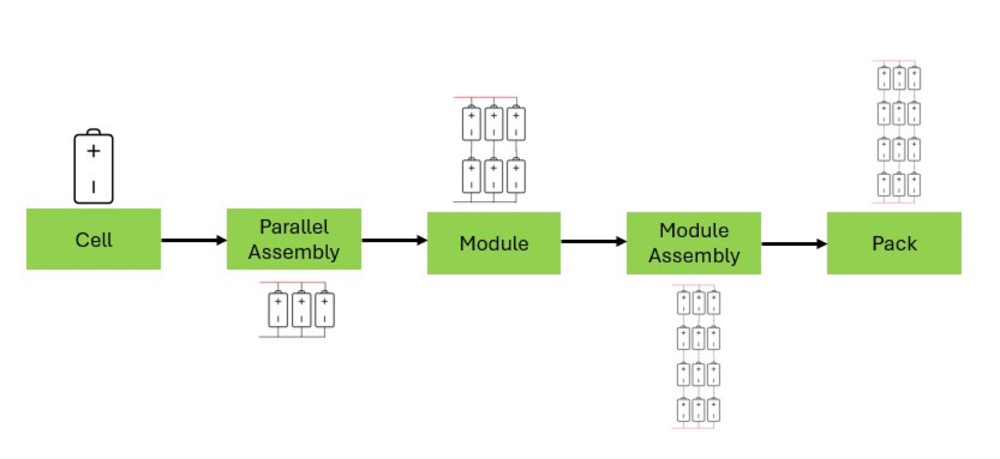
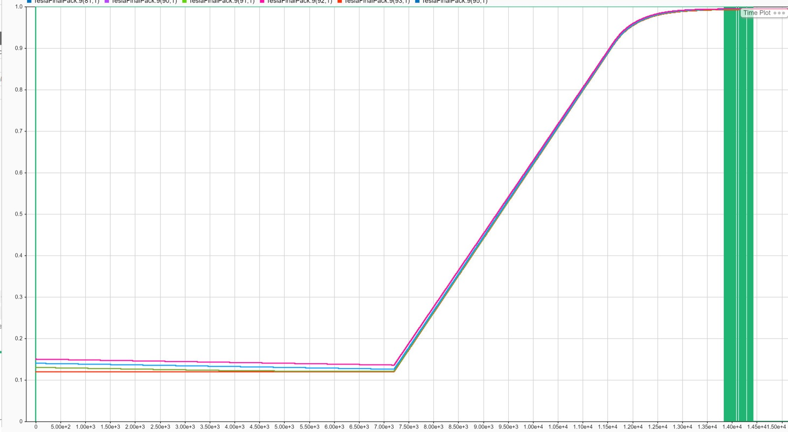
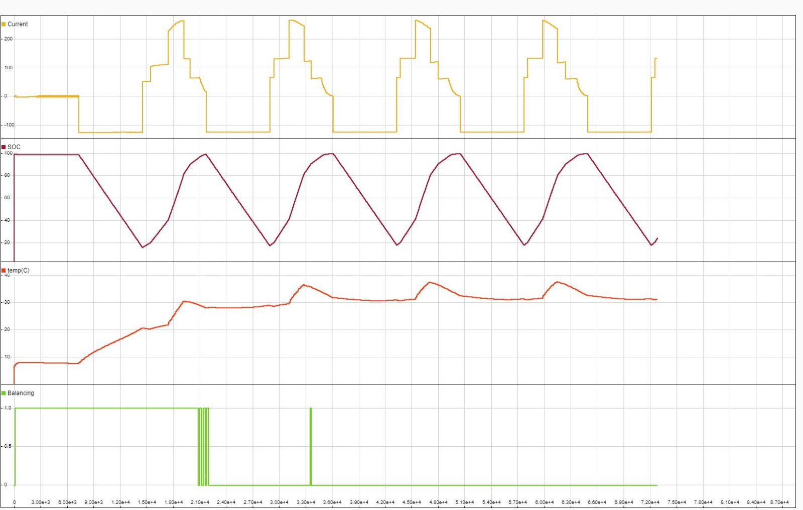

Every electric car battery is managed by a **Battery Management System (BMS)**. It decides how fast the pack can charge, tracks how much energy is left and how worn the cells are, keeps the cells evenly charged and at a safe temperature, and reports all of it to the rest of the car.

For my final-year project I built a complete BMS simulation environment in **MATLAB Simulink** and **Simscape**, wrapped around a realistic model of a **Tesla Model S** battery pack. I then tested it in conditions a real car would face, such as a heatwave fast-charge and a freezing morning. The aim was a model that any engineer can open, change, and use to test BMS algorithms safely, without risking a real 400 V pack.

## Building the pack

I chose the Model S because it uses **Panasonic 18650 cells**, and MATLAB ships with full parameter data for that cell. That makes the simulated electrical behaviour close to the real car's.

- **74 cells in parallel → 6 in series per module → 16 modules in series**, for **7,104 cells** in total
- I built it in MATLAB's **Battery Builder** app, with a thermal port, a true-SOC output port, heat transfer between neighbouring cells, a U-shaped liquid cooling plate, and balancing resistors on every module
- Each 74-cell parallel group is **lumped** into one equivalent cell. A real modular BMS sees each group as one voltage, one current and one temperature anyway, and lumping keeps simulation time manageable.
- All pack parameters and starting conditions are exported to an **editable .m file**, so a test can start at any charge level, temperature or cycle count

## Smart charging: three rules stacked on top of each other

Simulink's built-in CC-CV charger (constant current, then constant voltage, with a 4.1 V cell limit and a PI controller) is a starting point. Real cars are much more careful about how fast they charge, so I added **three custom MATLAB function blocks** that each limit the charging current:

1. **What the charger can supply.** I fitted a curve to real charger ratings: 120 V gives 12–16 A, 240 V gives 16–40 A, and a 480 V fast charger gives up to 200 A. The resulting quadratic sets the current ceiling for whatever charger is plugged in.
2. **How warm the cells are.** Lithium-ion cells charge fastest around 25 °C and shouldn't be charged near freezing or above about 45 °C. I fitted a 4th-order curve to that data (checked in both Excel and MATLAB's `polyfit`) to scale the current from 0 to 100 %. Outside 0–50 °C, charging is cut to zero.
3. **How full the battery is.** Using power measurements from a real Tesla charging session, this is a multistage CC-CV taper

The output passes through a **unit delay** before the current source. Without it, the loop of battery → BMS → current → battery creates an algebraic loop that Simulink can't solve.

## State of charge

The **Coulomb counter** tracks charge in and out from the module current, using the 3.153 Ah cell capacity. I validated it by charging from 10 % at 150 A and comparing against the battery model's true charge level. The two curves overlap on the plot, and the difference is **0.04 %**.

I also set up a Kalman filter, which is the industry standard because it handles sensor noise. However, it needs cell parameters that the battery model doesn't provide, so I documented it as a limitation rather than feeding it made-up numbers.

## Cell balancing

- **Passive balancing** burns off extra charge from the fullest modules through shunt resistors
- It runs on **cell voltage rather than estimated charge**, so a drift in the charge estimate can't cause unwanted balancing
- It switches on whenever modules differ by more than **2 mV**
- **Test:** I started the modules at random charge levels between 12 and 15 %, left them idle for 2 hours, then charged for 2 hours. The largest gap went from **3 % → 1.6 % → 0.19 %**, and balancing switched off once every module was within 2 mV.
- The shunt resistance was reduced from 50 Ω to 2 Ω so the balancing finishes within a reasonable simulation time

## State of health from real-world data

Simulink's own SOH block needs internal-resistance growth, which the battery model doesn't output. It does output **discharge cycles**, so I built my own estimator:

- I started from **owner-reported Model S data** of battery health against distance driven, which has the same shape as Tesla's published curves
- Assuming about **420 km per full discharge**, I converted kilometres into cycles. For example, 200,000 km is about 476 cycles, which gives about 90 % health.

## Thermal management

The real Model S runs coolant ribbons between the cells, which Simscape can't model. I simplified the car's full thermal system down to the battery loop and built it with Simscape Fluids:

- **Coolant:** Glysantin G48, the fluid Tesla uses
- **Reservoir:** 18 L, matching the car
- **Radiator:** a heat-exchanger block with cold, humid air from the condenser fan on the other side
- **Heater/chiller:** a MATLAB function **heats below 5 °C and cools above 40 °C**, so a car parked in sub-zero weather can warm its battery before driving
- **Ambient air:** convection over the pack's **2.63 m²** surface

In a 4-hour test alternating hourly between charging and discharging, the pack peaked at **41 °C** while charging and was brought back down. That came from the cooling and the temperature-based current limit working together.

## Telling the driver: CAN and a dashboard

- A virtual **CAN bus** built with the Vehicle Network Toolbox: every BMS signal is **packed** (with bit length, message ID and data type), **transmitted**, **received** and **unpacked**, just as it would travel to a car's control unit
- **Fault detection blocks** raise a flag when voltage, current or temperature go outside their limits
- A **live dashboard** built from the received signals shows power (V × I), estimated range (charge level × full range), battery level, health, and indicator lights for balancing and coolant over 50 °C. Each reading has a warning symbol that turns red on a fault.

It's also very useful while developing: you can watch a multi-hour simulation unfold without digging through scope windows.

## Putting it under stress

**Test A: fast-charging on a 45 °C day.** Cells started at 40 °C and the charger was 480 V. The temperature limit kept the current well below 200 A, so a full charge took **3.5 hours**, longer than usual but the right behaviour. The steps of the charge-level taper are clearly visible in the current trace.

**Test B: a 7 °C winter morning.** Module charge levels were randomised between 95 and 100 %. The pack sat idle for 2 hours while it **balanced and warmed itself up**, then went through four cycles of discharging at 120 A and recharging. The pack never went above **37 °C** while charging.

## What I'd do next

- Active balancing and a properly calibrated Kalman filter inside the simulation
- A more realistic thermal system, designed together with mechanical engineers
- Hardware-in-the-loop testing, running these algorithms and CAN messages on real boards

## What I learned

A BMS is really several control loops sharing one battery: charging, thermal, balancing and estimation all affect each other. Testing each block on its own before wiring them together (the Coulomb counter, the balancer, the cooling loop) is what made the full-system tests easy to trust. The project also taught me to work from real data whenever MATLAB didn't provide it: charger ratings, owner-reported battery health, and Tesla's charging behaviour all became curve fits inside the model.
